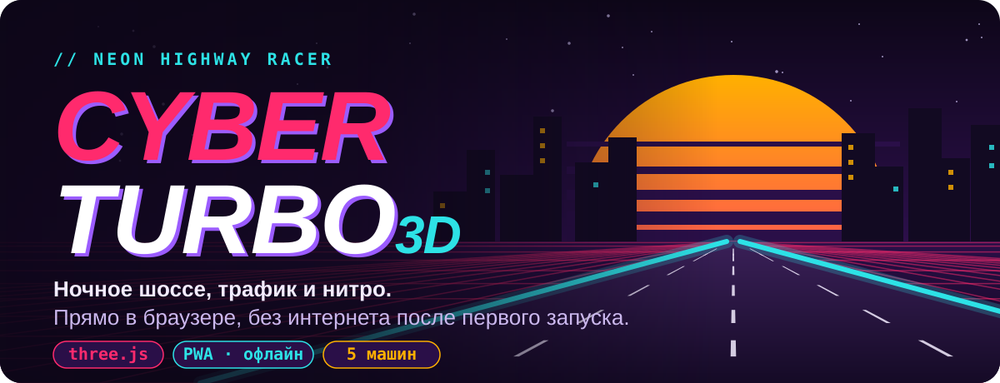
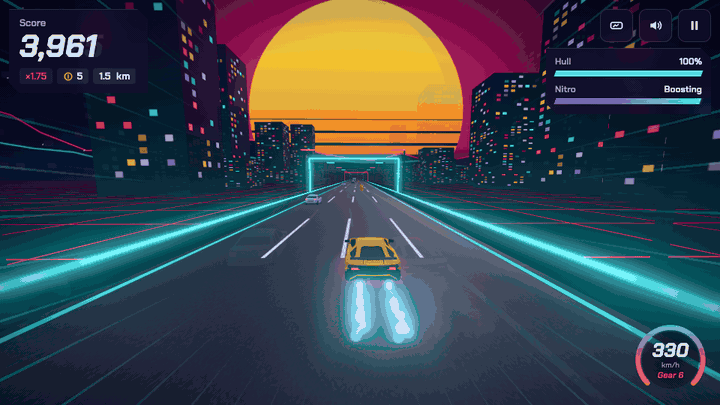
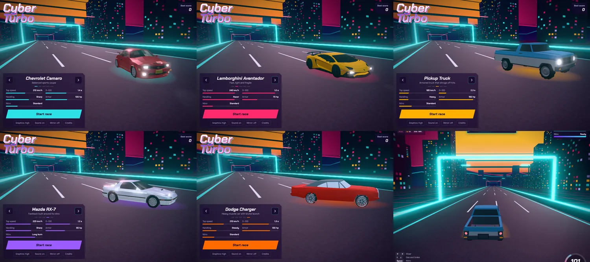
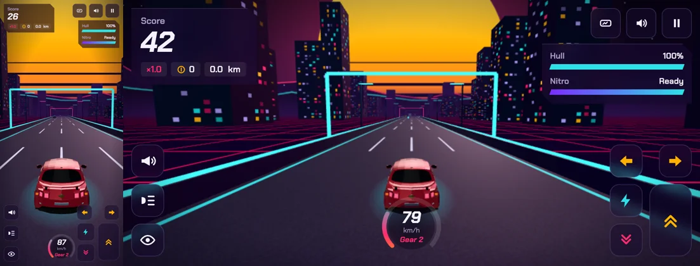

<p align="center">
  <a href="https://cyber-turbo.vercel.app">
    
  </a>
</p>

<p align="center">
  Неоновая гонка по ночному шоссе на three.js. Устанавливается как PWA на телефон и компьютер, открывается во весь экран и играется без интернета.
</p>

<p align="center">
  <b><a href="https://cyber-turbo.vercel.app">Играть: cyber-turbo.vercel.app</a></b>
  &nbsp;·&nbsp; <a href="#установка-игроками">Установить</a>
  &nbsp;·&nbsp; <a href="#быстрый-старт-локально">Запустить локально</a>
  &nbsp;·&nbsp; <a href="#credits">Credits</a>
</p>

<p align="center">
  
</p>

<p align="center"><sub>Настоящий геймплей: нитро, трафик, закат. Запись из игры без монтажа.</sub></p>

## Возможности

- **5 машин.** Camaro, Aventador, Pickup, RX-7, Charger. У каждой свои скорость, разгон, управляемость, броня и нитро.
- **Живой трафик.** Седаны, внедорожник, полиция, хэтчбек, грузовик держат дистанцию, тормозят и объезжают.
- **Свет и повреждения.** Фары, стоп-сигналы и поворотники на моделях; отлетающие детали при авариях; ремкомплект возвращает и броню, и вид.
- **Руль где удобно.** Кнопки или клавиатура; на телефоне ещё и наклон. Зеркало заднего вида и взгляд назад.
- **PWA без интернета.** Ставится как приложение, после первого запуска работает офлайн. Сборщик не нужен.
- **Запасной вариант.** Если 3D-модели не загрузились, играет встроенная версия машин из кода.

## Гараж

<p align="center">
  
</p>

| Машина | Макс. скорость | Броня | Характер |
|---|---:|---:|---|
| Chevrolet Camaro | 210 км/ч | 100 | сбалансированное спорт-купе |
| Lamborghini Aventador | 245 км/ч | 70 | быстрая, лёгкая, хрупкая |
| Pickup Truck | 185 км/ч | 160 | бронированный грузовик, держит удары |
| Mazda RX-7 | 225 км/ч | 90 | фастбэк, построенный вокруг нитро |
| Dodge Charger | 215 км/ч | 130 | тяжёлый мускул-кар с жёстким стартом |

<details>
<summary><b>Как ведёт себя трафик</b></summary>

<br>

- Машины держат дистанцию, тормозят за тобой и объезжают, если ты едешь медленно.
- Не перестраиваются прямо в тебя.
- На гудок и моргание фарами уступают полосу, на поворотник пропускают.

</details>

## Управление

| | Клавиатура | Телефон |
|---|---|---|
| Руль | ← → или A D | кнопки слева; в гараже можно включить руление наклоном телефона («Steering: tilt») |
| Газ / тормоз | ↑ ↓ или W S | кнопки справа |
| Нитро | Space или Shift | кнопка с молнией (газ жать не нужно) |
| Гудок | H | кнопка с рупором (ближайшая машина впереди в твоей полосе перестроится) |
| Дальний свет | L | кнопка с лучами (тот же эффект, плюс вспышка фар) |
| Поворотники | Q (левый) / E (правый) | две янтарные кнопки со стрелками (повтор — выключить; гаснут сами после смены полосы) |
| Зеркало заднего вида | кнопка в HUD (рядом с паузой) или «Mirror» в гараже | кнопка в HUD |
| Оглянуться | C (удерживать) | кнопка с глазом (удерживать) |
| Пауза | P или Esc | кнопка паузы |

Машина поворачивает только в движении: на месте руль лишь поворачивает передние колёса.

<details>
<summary><b>Руление наклоном телефона</b></summary>

<br>

<p align="center">
  
</p>

1. В гараже нажми «Steering: buttons» → станет «Steering: tilt». На iPhone разреши доступ к датчику движения.
2. Ноль калибруется в момент старта: держи телефон как удобно. Полный поворот — наклон ~22°.
3. Раскладка в этом режиме: слева столбиком гудок, фары, взгляд назад; по центру спидометр; справа нитро, тормоз, газ, над ними поворотники.
4. Если датчик не отвечает (например, во встроенном браузере Telegram), через 1.5 с вернутся стрелки и появится подсказка открыть игру в Safari/Chrome.

</details>

## Установка игроками

- **Android (Chrome, Edge, Samsung Internet):** кнопка «Install app» в гараже или пункт меню «Установить приложение».
- **iPhone / iPad (Safari):** «Поделиться» → «На экран Домой». Кнопка «Install app» в игре показывает эту подсказку.
- **Windows / macOS / Linux (Chrome, Edge):** значок установки в адресной строке или кнопка «Install app».

После первого открытия игра сохраняется в кэш и дальше работает офлайн.

**Как поделиться.** Отправь ссылку https://cyber-turbo.vercel.app (например, в Telegram). Встроенный браузер Telegram не умеет устанавливать PWA, поэтому: ⋮ → «Открыть в браузере», дальше по инструкции выше.

## Быстрый старт (локально)

Нужен Node.js 18 или новее.

```bash
npm install
npm start
```

Открой http://localhost:5173. Команда `npm start` сначала обновляет список файлов в `sw.js` (`npm run sw`), а потом запускает локальный сервер.

Открывать `index.html` двойным кликом нельзя. ES-модули и service worker работают только через сервер (`http://localhost` или `https://`).

<details>
<summary><b>Проверка на телефоне в той же Wi-Fi сети</b></summary>

<br>

`serve` печатает адрес вида `http://192.168.x.x:5173`, и его можно открыть на телефоне. Игра там запустится, но установка и офлайн-режим работать не будут: браузеры разрешают service worker только по HTTPS или на localhost. Чтобы проверить установку, задеплой проект (см. ниже).

</details>

## Публикация

<details>
<summary><b>Вариант A: GitHub Pages (бесплатно, автоматически)</b></summary>

<br>

1. В репозитории открой Settings → Pages.
2. В Source выбери **GitHub Actions**.
3. Сделай любой push в `main`. Workflow из `.github/workflows/deploy.yml` сам обновит `sw.js` и опубликует игру.

Адрес будет вида `https://<логин>.github.io/cyber-turbo/`. Все пути в проекте относительные, поэтому подпапка работает.

</details>

<details>
<summary><b>Вариант B: Vercel (используется сейчас)</b></summary>

<br>

Из терминала: `npm run sw && vercel --prod`.

Автодеплой по push: Vercel → проект → Settings → Git → подключи репозиторий. Framework Preset: **Other**, Build Command пустой, Output Directory `.`. Заголовки для `sw.js` уже лежат в `vercel.json`.

С Vercel перед каждым коммитом запускай `npm run sw`, иначе игроки не получат обновление. В варианте A это делается автоматически.

</details>

### Обновления

При изменении любого файла `npm run sw` вычисляет новый хэш версии. У игроков с открытой игрой появится плашка «A new version is ready → Reload». Остальные получат новую версию при следующем запуске.

## Структура

Сборщик не нужен: всё работает как статические файлы, без интернета и CDN.

<details>
<summary><b>Карта файлов</b></summary>

```
index.html             разметка и importmap
css/style.css          стили, шрифты
js/game.js             игра (three.js, физика, звук, HUD)
js/pwa.js              установка, service worker, плашка обновления
sw.js                  офлайн-кэш (блок <generated> создаёт скрипт)
manifest.webmanifest   имя, иконки, режим fullscreen
icons/                 иконки и скриншоты для окна установки
fonts/                 Chakra Petch (SIL OFL)
vendor/three/          three.js r170 и нужные addons, GLTFLoader, meshopt-декодер (MIT)
models/                3D-модели машин (GLB, meshopt + webp)
scripts/build-sw.mjs   генератор списка файлов для sw.js
assets/readme/         картинки для этого README
```

</details>

Репозиторий: https://github.com/komilovsg/cyber-turbo

## Лицензии

three.js распространяется под MIT (`vendor/three/LICENSE`), шрифт Chakra Petch под SIL Open Font License (`fonts/OFL.txt`).

## Credits

3D car models (converted to GLB, compressed with meshopt and WebP textures). CC-BY 4.0: https://creativecommons.org/licenses/by/4.0/

- Chevrolet Camaro by PuKkBuMXDD, CC-BY 4.0, [source](https://poly.pizza/m/kVcKsd2dEk)
- Lamborghini Aventador by Ignition Labs, CC-BY 4.0, [source](https://poly.pizza/m/5zUWP5UsLg-)
- Mazda RX-7 by IvOfficial, CC-BY 4.0, [source](https://poly.pizza/m/SnIoWlh7S2)
- Dodge Charger by David Sirera, CC-BY 4.0, [source](https://poly.pizza/m/4b80hRVxqvv)
- Cesium Milk Truck by Cesium, CC-BY 4.0, [source](https://github.com/KhronosGroup/glTF-Sample-Assets/tree/main/Models/CesiumMilkTruck)
- Pickup Truck by Quaternius, CC0, [source](https://poly.pizza/m/qn4grQgHm8)
- Car (sedan) by Quaternius, CC0, [source](https://poly.pizza/m/Cz6yDaUcM9)
- Car (sedan 2) by Quaternius, CC0, [source](https://poly.pizza/m/unqqkULtRU)
- SUV by Quaternius, CC0, [source](https://poly.pizza/m/xsMtZhBkxL)
- Police Car by Quaternius, CC0, [source](https://poly.pizza/m/BwwnUrWGmV)
- Car Hatchback by Kay Lousberg, CC0, [source](https://poly.pizza/m/BG0KAhmGDt)
- three.js, MIT, https://threejs.org
